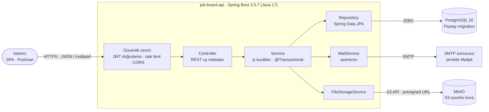
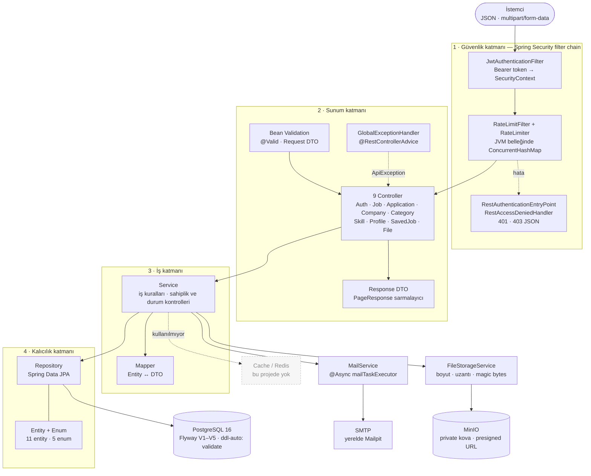

# Job Board & Application API

Java 17 ve Spring Boot 3.5.7 ile geliştirilmiş, JWT tabanlı rol yönetimine sahip bir iş ilanı ve başvuru yönetim REST API'si. İşverenler firma oluşturup ilan yayınlayabilir, adaylar CV yükleyip başvurabilir; başvurular `APPLIED → REVIEWED → HIRED / REJECTED` akışıyla yönetilir.

## Özellikler

- **JWT kimlik doğrulama:** Access token + yenileme (refresh) tokenı, BCrypt şifreleme ve stateless oturum.
- **Rol bazlı yetkilendirme:** `CANDIDATE`, `EMPLOYER` ve `ADMIN` rolleri; kayıt sırasında `ADMIN` rolü oluşturulamaz.
- **Firma ve ilan yönetimi:** İşveren başına tek firma; taslak, yayında, kapalı ve arşiv durumları.
- **Başvuru akışı:** Aynı ilana ikinci başvuru engeli, katı durum geçiş kuralları ve sahiplik kontrolleri.
- **Arama ve sayfalama:** Başlık/açıklamada anahtar kelime, konumda şehir filtresi; tüm listeler sayfalanır.
- **CV depolama:** MinIO (S3-uyumlu) üzerinde PDF, DOC ve DOCX; 5 MB boyut sınırı ve imzalı indirme bağlantısı.
- **E-posta bildirimleri:** Başvuru alındığında ve durum değiştiğinde asenkron e-posta; yerelde Mailpit ile görüntülenir.
- **Merkezi hata yönetimi:** Doğrulama, kimlik, yetki ve iş kuralı hataları için tutarlı JSON yanıtı.
- **Veritabanı sürümleme:** Flyway migration ve Hibernate `ddl-auto: validate`.
- **Testler:** JUnit 5 + Mockito servis testleri.

## Teknoloji Stack

| Katman | Teknoloji |
|--------|-----------|
| Dil / çalışma zamanı | Java 17 |
| Framework | Spring Boot 3.5.7, Spring Web, Spring Data JPA |
| Güvenlik | Spring Security, JJWT 0.12.6, BCrypt |
| Veritabanı | PostgreSQL 16, Flyway |
| Dosya depolama | MinIO (S3 uyumlu) |
| E-posta | Spring Mail, Mailpit (yerel SMTP) |
| Doğrulama | Jakarta Bean Validation |
| Test | JUnit 5, Mockito, AssertJ |
| Derleme | Maven Wrapper 3.9.9 |
| Yardımcı araçlar | Lombok |

## Mimari



İstemci isteği güvenlik zincirinden geçer; Controller → Service → Repository hattı PostgreSQL'e ulaşır. Service katmanı ayrıca CV'ler için MinIO'ya, bildirimler için SMTP sunucusuna bağlanır.

- Controller yalnızca HTTP katmanını yönetir.
- İş kuralları ve transaction sınırları Service katmanındadır.
- Entity'ler doğrudan dışarı açılmaz; Request/Response DTO'ları ve manuel mapper'lar kullanılır.
- Hatalar `ApiException` alt sınıfları ve `GlobalExceptionHandler` ile tek noktadan üretilir.

### Katmanlı Mimari



Her katman yalnızca bir sonrakine bağlıdır: güvenlik zinciri isteği doğrular, Controller DTO/validasyonla sınırlı kalır, iş kuralları ve transaction sınırları Service'te yaşar, kalıcılık Repository üzerinden PostgreSQL'e gider. Projede Redis/cache katmanı yoktur; rate limiting JVM belleğinde tutulur.

## Hızlı Başlangıç

### Gereksinimler

- JDK 17
- Docker Desktop (PostgreSQL, MinIO ve Mailpit için)
- Maven zorunlu değildir; proje Maven Wrapper içerir.

### 1. Projeyi klonla

```bash
git clone <repository-url>
cd job-board-api
```

### 2. Ortam değişkenlerini yapılandır

```bash
cp .env.example .env
```

`.env` dosyasını açın ve gerekli değerleri doldurun. Bu dosya asla depoya commitlenmez (`.gitignore` içinde).

### 3. Yerel servisleri başlat

```bash
docker compose up -d
docker compose ps
```

İlk açılışta imajlar indirileceği için PostgreSQL'in `healthy` olması biraz sürebilir.

| Servis | Adres | Yerel giriş |
|--------|-------|-------------|
| PostgreSQL | `127.0.0.1:5432` | `.env` içindeki `POSTGRES_*` değerleri |
| MinIO API | `http://127.0.0.1:9000` | `.env` içindeki `MINIO_ROOT_*` değerleri |
| MinIO Konsolu | `http://127.0.0.1:9001` | `.env` içindeki `MINIO_ROOT_*` değerleri |
| Mailpit SMTP | `127.0.0.1:1025` | — |
| Mailpit Arayüzü | `http://127.0.0.1:8025` | — |
| Uygulama | `http://localhost:8080` | — |

### 4. Uygulamayı başlat

Maven Wrapper ile:

```bash
# macOS / Linux / Git Bash
./mvnw spring-boot:run

# Windows CMD / PowerShell
mvnw.cmd spring-boot:run
```

Maven kuruluysa `mvn spring-boot:run` de kullanılabilir. IntelliJ IDEA'dan `JobBoardApiApplication` sınıfı da çalıştırılabilir.

İlk açılışta Flyway tabloları oluşturur; `DataInitializer` varsayılan kategori ve yetenekleri ekler. Uygulama varsayılan olarak `8080` portunu dinler.

### 5. Çalıştığını doğrula

```bash
curl http://localhost:8080/api/categories
```

`200 OK` ve kategori listesi dönmelidir.

## Ortam Değişkenleri

`.env.example` dosyası gerekli tüm değişkenleri içerir. Önemli değişkenler:

| Değişken | Açıklama | Zorunlu |
|----------|----------|---------|
| `DB_URL` | JDBC bağlantı adresi | Hayır |
| `DB_USERNAME` | Veritabanı kullanıcısı | Hayır |
| `DB_PASSWORD` | Veritabanı şifresi | Evet |
| `JWT_SECRET` | Access token imzalama anahtarı (en az 32 karakter) | Evet |
| `MINIO_ENDPOINT` | MinIO API adresi | Hayır |
| `MINIO_ACCESS_KEY` | MinIO erişim anahtarı | Evet |
| `MINIO_SECRET_KEY` | MinIO gizli anahtarı | Evet |
| `MINIO_BUCKET` | CV kovası adı | Hayır |
| `MAIL_HOST` | SMTP sunucusu | Hayır |
| `MAIL_PORT` | SMTP portu | Hayır |
| `MAIL_ENABLED` | E-posta gönderimini açar/kapatır | Hayır |

PostgreSQL ve MinIO container'ları için ayrıca `POSTGRES_USER`, `POSTGRES_PASSWORD`, `MINIO_ROOT_USER`, `MINIO_ROOT_PASSWORD` gereklidir.

## Kimlik Doğrulama ve Roller

| Rol | Yetkiler |
|-----|----------|
| `CANDIDATE` | Profil, CV yükleme, ilan arama, başvuru, ilan kaydetme |
| `EMPLOYER` | Firma yönetimi, ilan oluşturma/yayınlama/kapatma, başvuru değerlendirme |
| `ADMIN` | Rol tanımlıdır ancak public kayıtla oluşturulamaz |

Kayıt veya giriş yanıtındaki `accessToken` korumalı isteklerde şu başlıkla gönderilir:

```http
Authorization: Bearer <accessToken>
```

- `POST /api/auth/refresh` — yenileme tokenını döndürür ve eski tokenı iptal eder (rotation).
- `POST /api/auth/logout` — kullanıcının tüm yenileme tokenlarını iptal eder.
- Şifreler BCrypt ile saklanır.

## API Uç Noktaları

### Kimlik Doğrulama

| Metot | Yol | Erişim | Açıklama |
|-------|-----|--------|----------|
| `POST` | `/api/auth/register` | Herkese açık | Aday veya işveren kaydı |
| `POST` | `/api/auth/login` | Herkese açık | Giriş; token çifti döner |
| `POST` | `/api/auth/refresh` | Herkese açık | Refresh token ile yeni token çifti |
| `POST` | `/api/auth/logout` | Giriş gerekli | Tüm refresh tokenları iptal eder |

### Genel (Herkese Açık)

| Metot | Yol | Erişim | Açıklama |
|-------|-----|--------|----------|
| `GET` | `/api/categories` | Herkese açık | Kategorileri listeler |
| `GET` | `/api/skills` | Herkese açık | Yetenekleri listeler |
| `GET` | `/api/jobs` | Herkese açık | `keyword`, `city` ve sayfalama ile ilan arar |
| `GET` | `/api/jobs/{id}` | Herkese açık | Yayındaki ilan detayı; sahibi taslağı da görebilir |
| `GET` | `/api/companies/{id}` | Herkese açık | Firma detayı |

### Aday (`CANDIDATE`)

| Metot | Yol | Açıklama |
|-------|-----|----------|
| `GET` | `/api/profile/me` | Profili getirir |
| `PUT` | `/api/profile/me` | Profili günceller |
| `POST` | `/api/files/cv` | PDF/DOC/DOCX CV yükler |
| `POST` | `/api/jobs/{jobId}/applications` | İlana başvurur |
| `GET` | `/api/applications/me` | Kendi başvurularını listeler |
| `POST` | `/api/jobs/{jobId}/save` | İlanı kaydeder |
| `DELETE` | `/api/jobs/{jobId}/save` | Kaydı kaldırır |
| `GET` | `/api/saved-jobs` | Kaydedilen ilanları listeler |

### İşveren (`EMPLOYER`)

| Metot | Yol | Açıklama |
|-------|-----|----------|
| `POST` | `/api/companies` | Firma oluşturur |
| `GET` | `/api/companies/me` | Kendi firmasını getirir |
| `PUT` | `/api/companies/me` | Firmasını günceller |
| `GET` | `/api/jobs/me` | Kendi ilanlarını listeler |
| `POST` | `/api/jobs` | Taslak ilan oluşturur |
| `PUT` | `/api/jobs/{id}` | İlanı günceller |
| `PATCH` | `/api/jobs/{id}/publish` | İlanı yayınlar |
| `PATCH` | `/api/jobs/{id}/close` | Yayındaki ilanı kapatır |
| `PATCH` | `/api/jobs/{id}/archive` | İlanı arşivler |
| `GET` | `/api/jobs/{jobId}/applications` | İlan başvurularını listeler |
| `PATCH` | `/api/applications/{id}/status` | Başvuru durumunu değiştirir |

### Dosya

| Metot | Yol | Erişim | Açıklama |
|-------|-----|--------|----------|
| `GET` | `/api/files/presign?objectKey=cvs/{userId}/...` | Aday | Kendi CV'si için imzalı URL |
| `GET` | `/api/files/applications/{applicationId}/cv-url` | İşveren | Başvuru CV'si için imzalı URL |

Başarılı yanıtlar: oluşturma `201`, okuma/güncelleme `200`, silme ve çıkış `204`. Sayfalı yanıtlar `content`, `page`, `size`, `totalElements`, `totalPages` ve `last` alanlarını içerir.

## Örnek Akış

### 1. Aday kaydı

```bash
curl -X POST http://localhost:8080/api/auth/register \
  -H "Content-Type: application/json" \
  -d '{
    "email": "aday@example.com",
    "password": "Password123!",
    "fullName": "Aday Kullanıcı",
    "role": "CANDIDATE"
  }'
```

### 2. Firma ve ilan (işveren tokenı ile)

```bash
curl -X POST http://localhost:8080/api/auth/login \
  -H "Content-Type: application/json" \
  -d '{"email":"isveren@example.com","password":"Password123!"}'
```

```bash
curl -X POST http://localhost:8080/api/companies \
  -H "Authorization: Bearer $EMPLOYER_TOKEN" \
  -H "Content-Type: application/json" \
  -d '{"name":"Örnek Firma","description":"Yazılım şirketi","location":"İstanbul"}'
```

```bash
curl -X POST http://localhost:8080/api/jobs \
  -H "Authorization: Bearer $EMPLOYER_TOKEN" \
  -H "Content-Type: application/json" \
  -d '{
    "title": "Java Developer",
    "description": "Spring Boot ile backend geliştirme.",
    "requirements": "Java 17, Spring Boot, SQL",
    "location": "İstanbul",
    "employmentType": "FULL_TIME",
    "workMode": "HYBRID",
    "minSalary": 60000,
    "maxSalary": 90000,
    "categoryId": 1,
    "skillIds": [1, 2, 3],
    "expiresAt": "2027-12-31T23:59:59Z"
  }'
```

```bash
curl -X PATCH http://localhost:8080/api/jobs/1/publish \
  -H "Authorization: Bearer $EMPLOYER_TOKEN"
```

### 3. CV ve başvuru (aday tokenı ile)

```bash
curl -X POST http://localhost:8080/api/files/cv \
  -H "Authorization: Bearer $CANDIDATE_TOKEN" \
  -F "file=@cv.pdf;type=application/pdf"
```

Dönen `objectKey` değerini profil veya başvuru `cvUrl` alanına yazın.

```bash
curl -X POST http://localhost:8080/api/jobs/1/applications \
  -H "Authorization: Bearer $CANDIDATE_TOKEN" \
  -H "Content-Type: application/json" \
  -d '{"coverLetter":"Pozisyonla ilgileniyorum."}'
```

### 4. Değerlendirme (işveren tokenı ile)

```bash
curl -X PATCH http://localhost:8080/api/applications/1/status \
  -H "Authorization: Bearer $EMPLOYER_TOKEN" \
  -H "Content-Type: application/json" \
  -d '{"status":"REVIEWED"}'
```

## İş Kuralları

- Aynı aday aynı ilana yalnızca bir kez başvurabilir; veritabanında da benzersiz kısıt vardır.
- Yalnızca `PUBLISHED` ve süresi dolmamış ilanlara başvurulur.
- Başvuru için adayın profilinde veya istekte geçerli bir CV anahtarı bulunmalıdır.
- Durum geçişleri katıdır:
  - `APPLIED → REVIEWED`
  - `REVIEWED → HIRED` veya `REVIEWED → REJECTED`
  - `HIRED` ve `REJECTED` son durumdur.
- Aynı duruma tekrar geçiş idempotent kabul edilir; e-posta tekrar gönderilmez.
- Firma ve ilan işlemlerinde sahiplik kontrolü yapılır; başka işverenin kaynağına erişim `403` döner.
- İlan `DRAFT` olarak oluşturulur; yayınlama, kapatma ve arşivleme ayrı uç noktalardadır.
- Arama yalnızca yayında ve süresi dolmamış ilanları getirir; `keyword` başlık/açıklamada, `city` konumda aranır.

## Hata Formatı

Tüm hatalar aynı gövdeyle döner:

```json
{
  "timestamp": "2026-11-05T21:00:00Z",
  "status": 400,
  "error": "Bad Request",
  "message": "Doğrulama hatası",
  "path": "/api/jobs",
  "validationErrors": {
    "title": "must not be blank"
  }
}
```

| Kod | Anlamı |
|-----|--------|
| `400` | Geçersiz istek, doğrulama hatası veya geçersiz durum geçişi |
| `401` | Eksik/geçersiz access token veya hatalı giriş |
| `403` | Rol veya kaynak sahipliği yetersiz |
| `404` | Kaynak bulunamadı |
| `409` | Çakışma (ör. e-posta ya da başvuru zaten mevcut) |
| `500` | Beklenmeyen sunucu hatası |

## Testleri Çalıştırma

```bash
./mvnw test
```

Windows:

```text
mvnw.cmd test
```

Test suite'i Mockito/JUnit ile veritabanı gerektirmeden servis kurallarını, JWT/refresh token davranışlarını, dosya erişim doğrulamasını, mail bildirimlerini ve temel hata yanıtlarını doğrular.

Entegrasyon testleri (PostgreSQL + MinIO için Testcontainers kullanır, Docker gerektirir):

```bash
./mvnw test -Dintegration.tests.enabled=true
```

## Postman

Hazır koleksiyon: `postman/job-board-api.postman_collection.json`

1. Postman'de **Import** ile koleksiyonu içe aktarın.
2. `baseUrl` değişkeninin `http://localhost:8080` olduğunu kontrol edin.
3. Tokenları ve oluşturulan kimlikleri test scriptleriyle otomatik kaydedilir.

## Proje Yapısı

```
job-board-api/
├── .mvn/wrapper/                 # Maven Wrapper yapılandırması
├── mvnw, mvnw.cmd                # Maven Wrapper betikleri
├── Dockerfile                    # Uygulama imajı (multi-stage)
├── docker-compose.yml            # PostgreSQL + MinIO + Mailpit
├── .gitattributes                # Wrapper satır sonları
├── .gitignore                    # Git dışı dosyalar
├── .env.example                  # Ortam değişkeni referansı
├── postman/                      # Postman koleksiyonu
├── pom.xml                       # Maven yapılandırması
├── src/main/java/com/jobboard/api/
│   ├── config/                   # Security, async, MinIO, seed verisi
│   ├── controller/               # REST uç noktaları
│   ├── dto/                      # Request ve Response kayıtları
│   ├── entity/                   # JPA entity'leri ve enum'lar
│   ├── exception/                # İş hataları ve merkezi handler
│   ├── mapper/                   # Entity ↔ DTO dönüşümleri
│   ├── repository/               # Spring Data JPA arayüzleri
│   ├── security/                 # JWT filtreleri ve user details
│   └── service/                  # İş kuralları ve transaction'lar
├── src/main/resources/
│   ├── application.yml
│   └── db/migration/            # Flyway migration'ları
└── src/test/java/com/jobboard/api/
    ├── controller/              # Controller testleri
    ├── exception/               # Exception handler testleri
    ├── integration/             # Entegrasyon testleri (Docker gerekli)
    └── service/                 # Servis testleri
```

## Güvenlik Notları

- Üretimde `JWT_SECRET`, veritabanı ve MinIO kimlik bilgileri ortam değişkenlerinden verilmelidir.
- Depoya gerçek `.env`, anahtar veya sertifika eklenmemelidir; `.env` ve `secrets/` klasörü `.gitignore` içindedir.
- CV yüklemesinde hem uzantı hem `Content-Type` hem de dosya imzası (magic bytes) kontrol edilir.
- MinIO kovası varsayılan olarak private'tır; erişim kısa ömürlü imzalı URL ile sağlanır.
- Public ilan ve firma uç noktaları yalnızca okuma amaçlıdır; tüm yazma işlemleri kimlik doğrulaması ve rol kontrolü gerektirir.

## Lisans

Bu depoda henüz bir lisans dosyası bulunmuyor. Kullanım ve yeniden dağıtım koşulları için depo sahibiyle iletişime geçin.
