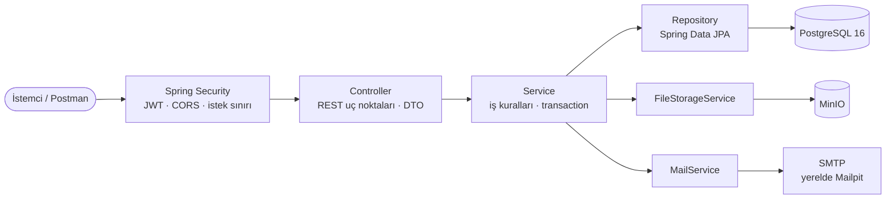

# Job Board & Application API

İşverenlerin ilan yayınlayabildiği, adayların ilan arayıp başvuru yapabildiği bir REST API. Uygulama Java 17 ve Spring Boot 3.5.7 ile geliştirilmiştir. Adaylar CV’lerini yükleyebilir; işverenler başvuruları inceleyip durumlarını güncelleyebilir.

## Neler sunuyor?

- JWT tabanlı kimlik doğrulama; access ve refresh token desteği
- `CANDIDATE`, `EMPLOYER` ve `ADMIN` rolleri için yetkilendirme
- İşverenler için şirket ve ilan yönetimi
- Adaylar için ilan arama, CV yükleme ve başvuru takibi
- Başlık, açıklama ve şehir bilgisine göre arama; sayfalı listeleme
- CV’leri MinIO’da saklama ve süreli indirme bağlantıları oluşturma
- Başvuru ve durum değişiklikleri için e-posta bildirimi
- Flyway ile veritabanı şema yönetimi

## Kullanılan teknolojiler

| Alan | Teknoloji |
|---|---|
| Dil | Java 17 |
| Uygulama çatısı | Spring Boot 3.5.7, Spring Web, Spring Data JPA |
| Kimlik doğrulama | Spring Security, JJWT 0.12.6, BCrypt |
| Veritabanı | PostgreSQL 16, Flyway |
| Dosya saklama | MinIO (S3 uyumlu) |
| E-posta | Spring Mail; yerel geliştirmede Mailpit |
| Doğrulama | Jakarta Bean Validation |
| Test | JUnit 5, Mockito, AssertJ, Testcontainers |
| Derleme | Maven Wrapper 3.9.9 |

## Mimari

İstekler önce Spring Security zincirinden geçer. Controller katmanı HTTP isteklerini ve DTO’ları yönetir; iş kuralları Service katmanında uygulanır. Veritabanı erişimi Spring Data JPA repository’leri üzerinden yapılır. CV dosyaları MinIO’ya, e-posta bildirimleri SMTP sunucusuna gönderilir.



Entity’ler doğrudan API yanıtı olarak kullanılmaz; dışarıya Request/Response DTO’ları verilir. Hatalar merkezi exception handler üzerinden tutarlı JSON yanıtlarına dönüştürülür. İstek sınırı uygulaması JVM belleğinde çalışır; projede Redis kullanılmıyor.

## Yerelde çalıştırma

### Gereksinimler

- JDK 17
- Docker Desktop (PostgreSQL, MinIO ve Mailpit için)
- Maven kurulumu gerekmez; proje Maven Wrapper içerir.

### 1. Depoyu klonlayın

```bash
git clone https://github.com/perteka/job-board-api.git
cd job-board-api
```

### 2. Ortam dosyasını hazırlayın

macOS/Linux veya Git Bash:

```bash
cp .env.example .env
```

Windows PowerShell:

```powershell
Copy-Item .env.example .env
```

`.env` dosyasındaki boş değerleri yerel ortamınıza göre doldurun. Gerçek parolaları ve anahtarları depoya göndermeyin; `.env` dosyası `.gitignore` içindedir.

### 3. Gerekli servisleri başlatın

```bash
docker compose up -d
docker compose ps
```

Compose, PostgreSQL, MinIO ve Mailpit’i başlatır. İlk çalıştırmada Docker imajlarının indirilmesi birkaç dakika sürebilir.

| Servis | Adres |
|---|---|
| PostgreSQL | `127.0.0.1:5432` |
| MinIO API | `http://127.0.0.1:9000` |
| MinIO konsolu | `http://127.0.0.1:9001` |
| Mailpit SMTP | `127.0.0.1:1025` |
| Mailpit arayüzü | `http://127.0.0.1:8025` |
| Uygulama | `http://localhost:8080` |

Yerel servis giriş bilgileri `.env` dosyasındaki `POSTGRES_*` ve `MINIO_ROOT_*` değişkenlerinden alınır.

### 4. Uygulamayı başlatın

macOS/Linux veya Git Bash:

```bash
./mvnw spring-boot:run
```

Windows PowerShell veya Komut İstemi:

```powershell
.\mvnw.cmd spring-boot:run
```

Uygulama başladıktan sonra kategorileri listeleyen uç noktayı çağırarak kontrol edebilirsiniz:

```bash
curl http://localhost:8080/api/categories
```

Başarılı yanıt `200 OK` ve kategori listesidir. Flyway, uygulama açılırken veritabanı migration’larını çalıştırır.

## Ortam değişkenleri

`.env.example` dosyasında kullanılan değişkenlerin tamamı bulunur. Başlangıç için özellikle şunları ayarlayın:

| Değişken | Açıklama |
|---|---|
| `DB_PASSWORD` | PostgreSQL bağlantı parolası |
| `JWT_SECRET` | Access token imzalama anahtarı; en az 32 karakter olmalı |
| `JWT_REFRESH_SECRET` | Refresh token imzalama anahtarı; belirtilmezse `JWT_SECRET` kullanılır |
| `MINIO_ACCESS_KEY` | Uygulamanın MinIO erişim anahtarı |
| `MINIO_SECRET_KEY` | Uygulamanın MinIO gizli anahtarı |
| `POSTGRES_PASSWORD` | Compose içindeki PostgreSQL kullanıcısının parolası |
| `MINIO_ROOT_PASSWORD` | MinIO yönetici parolası |

`DB_URL`, `DB_USERNAME`, `MINIO_ENDPOINT`, `MINIO_BUCKET`, `MAIL_HOST`, `MAIL_PORT` ve `MAIL_ENABLED` için uygulamada varsayılan değerler tanımlıdır. Compose servisleri için `POSTGRES_USER` ve `MINIO_ROOT_USER` değerleri de isteğe bağlı olarak değiştirilebilir.

## Roller ve kimlik doğrulama

| Rol | Erişim alanı |
|---|---|
| `CANDIDATE` | Profil, CV, ilan arama, başvuru ve kaydedilen ilanlar |
| `EMPLOYER` | Şirket profili, ilanlar ve başvuruların değerlendirilmesi |
| `ADMIN` | Uygulamada tanımlıdır; herkese açık kayıt üzerinden oluşturulamaz |

Kayıt ve giriş yanıtlarında dönen `accessToken`, korumalı uç noktalara şu başlıkla gönderilir:

```http
Authorization: Bearer <accessToken>
```

`POST /api/auth/refresh` refresh token’ı yeniler ve önceki token’ı geçersiz kılar. `POST /api/auth/logout` kullanıcının refresh token’larını iptal eder. Parolalar BCrypt ile saklanır.

## API özeti

### Kimlik doğrulama

| Metot | Yol | Açıklama |
|---|---|---|
| `POST` | `/api/auth/register` | Aday veya işveren kaydı |
| `POST` | `/api/auth/login` | Giriş ve token çifti |
| `POST` | `/api/auth/refresh` | Token yenileme |
| `POST` | `/api/auth/logout` | Oturum token’larını iptal etme |

### Herkese açık uç noktalar

| Metot | Yol | Açıklama |
|---|---|---|
| `GET` | `/api/categories` | Kategorileri listeler |
| `GET` | `/api/skills` | Yetenekleri listeler |
| `GET` | `/api/jobs` | İlanları arar; `keyword`, `city` ve sayfalama parametrelerini destekler |
| `GET` | `/api/jobs/{id}` | Yayındaki ilanı getirir; ilan sahibi taslağını da görebilir |
| `GET` | `/api/companies/{id}` | Şirket bilgilerini getirir |

### Aday uç noktaları (`CANDIDATE`)

| Metot | Yol | Açıklama |
|---|---|---|
| `GET` / `PUT` | `/api/profile/me` | Profili görüntüler veya günceller |
| `POST` | `/api/files/cv` | CV yükler (PDF, DOC veya DOCX) |
| `POST` | `/api/jobs/{jobId}/applications` | İlana başvurur |
| `GET` | `/api/applications/me` | Başvuruları listeler |
| `POST` / `DELETE` | `/api/jobs/{jobId}/save` | İlanı kaydeder veya kayıttan çıkarır |
| `GET` | `/api/saved-jobs` | Kaydedilen ilanları listeler |

### İşveren uç noktaları (`EMPLOYER`)

| Metot | Yol | Açıklama |
|---|---|---|
| `POST` | `/api/companies` | Şirket profili oluşturur |
| `GET` / `PUT` | `/api/companies/me` | Şirket profilini görüntüler veya günceller |
| `GET` | `/api/jobs/me` | İşverenin ilanlarını listeler |
| `POST` | `/api/jobs` | Taslak ilan oluşturur |
| `PUT` | `/api/jobs/{id}` | İlanı günceller |
| `PATCH` | `/api/jobs/{id}/publish` | İlanı yayınlar |
| `PATCH` | `/api/jobs/{id}/close` | İlanı kapatır |
| `PATCH` | `/api/jobs/{id}/archive` | İlanı arşivler |
| `GET` | `/api/jobs/{jobId}/applications` | İlan başvurularını listeler |
| `PATCH` | `/api/applications/{id}/status` | Başvuru durumunu değiştirir |

### Dosya erişimi

| Metot | Yol | Açıklama |
|---|---|---|
| `GET` | `/api/files/presign?objectKey=cvs/{userId}/...` | Adayın kendi CV’si için süreli indirme bağlantısı üretir |
| `GET` | `/api/files/applications/{applicationId}/cv-url` | İşverenin başvuru CV’sine erişmesi için bağlantı üretir |

Başarılı oluşturma yanıtları `201`, okuma ve güncelleme yanıtları `200`; silme ve çıkış yanıtları `204` döndürür. Sayfalı listelerde `content`, `page`, `size`, `totalElements`, `totalPages` ve `last` alanları bulunur.

## Başvuru akışı ve iş kuralları

Bir aday kayıt olduktan sonra ilanları listeleyebilir ve uygun bir ilana başvurabilir. İşveren kendi şirketini ve ilanlarını yönetir; başvuruları inceleyip durumlarını günceller.

Başvurularda izin verilen durum geçişleri şöyledir:

```text
APPLIED → REVIEWED → HIRED
                    ↘ REJECTED
```

- Aday aynı ilana ikinci kez başvuramaz; bu kural veritabanında da korunur.
- Başvuru yalnızca yayındaki ve süresi dolmamış ilanlara yapılabilir.
- Başvuru sırasında geçerli bir CV anahtarı gerekir.
- `HIRED` ve `REJECTED` son durumlardır. Aynı duruma tekrar geçiş yeni bildirim göndermez.
- İşveren yalnızca kendi şirketi, ilanları ve başvuruları üzerinde işlem yapabilir.
- Yeni ilanlar taslak olarak oluşturulur; yayınlama, kapatma ve arşivleme ayrı işlemlerdir.
- Arama sonuçlarında yalnızca yayındaki ve süresi dolmamış ilanlar yer alır.

## Hata yanıtları

API hataları `timestamp`, `status`, `error`, `message` ve `path` alanlarını içeren ortak bir JSON biçimi kullanır. Doğrulama hatalarında alan bazlı `validationErrors` bilgisi de döner.

```json
{
  "timestamp": "2026-11-09T12:00:00Z",
  "status": 400,
  "error": "Bad Request",
  "message": "Doğrulama hatası",
  "path": "/api/jobs",
  "validationErrors": {
    "title": "must not be blank"
  }
}
```

| HTTP kodu | Anlamı |
|---|---|
| `400` | Geçersiz istek, doğrulama hatası veya izin verilmeyen durum geçişi |
| `401` | Eksik/geçersiz access token veya hatalı giriş |
| `403` | Rol ya da kaynak sahipliği yetersiz |
| `404` | Kaynak bulunamadı |
| `409` | Çakışma; örneğin e-posta veya başvuru zaten mevcut |
| `500` | Beklenmeyen sunucu hatası |

## Testler

Tüm testleri çalıştırmak için:

```bash
./mvnw test
```

Windows:

```powershell
.\mvnw.cmd test
```

Birim testleri servis kurallarını, JWT ve refresh token davranışlarını, dosya erişimini, e-posta bildirimlerini ve hata yanıtlarını kapsar. Entegrasyon testleri PostgreSQL ve MinIO’yu Testcontainers ile başlatır; tam test paketini çalıştırırken Docker’ın açık olması gerekir.

Docker olmadan tek bir birim testini çalıştırmak için örnek:

```bash
./mvnw -Dtest=AuthServiceTest test
```

## Postman koleksiyonu

Hazır istekler `postman/job-board-api.postman_collection.json` dosyasındadır. Koleksiyonu Postman’e aktarın ve `baseUrl` değişkeninin `http://localhost:8080` olduğunu doğrulayın. İsteklerde kullanılan token ve kaynak kimlikleri koleksiyonun test betikleriyle saklanır.

## Proje yapısı

```text
src/main/java/com/jobboard/api/
├── config/       Uygulama ve altyapı yapılandırması
├── controller/   REST uç noktaları
├── dto/          İstek ve yanıt modelleri
├── entity/       JPA entity’leri ve enum’lar
├── exception/    İş hataları ve merkezi hata yönetimi
├── mapper/       Entity–DTO dönüşümleri
├── repository/   Spring Data JPA arayüzleri
├── security/     JWT ve Spring Security bileşenleri
└── service/      İş kuralları ve transaction yönetimi

src/main/resources/
├── application.yml
└── db/migration/   Flyway migration’ları

src/test/java/com/jobboard/api/
├── controller/
├── exception/
├── integration/    Testcontainers entegrasyon testleri
└── service/
```

## Güvenlik ve lisans

Üretim ortamında JWT, veritabanı ve MinIO kimlik bilgilerini ortam değişkenlerinden sağlayın. Gerçek `.env` dosyalarını, anahtarları veya sertifikaları depoya eklemeyin. CV yüklemelerinde uzantı, içerik türü ve dosya imzası denetlenir; MinIO kovası varsayılan olarak private tutulur.

Bu depoda henüz bir lisans dosyası bulunmuyor. Kullanım ve yeniden dağıtım koşulları için depo sahibiyle iletişime geçin.
